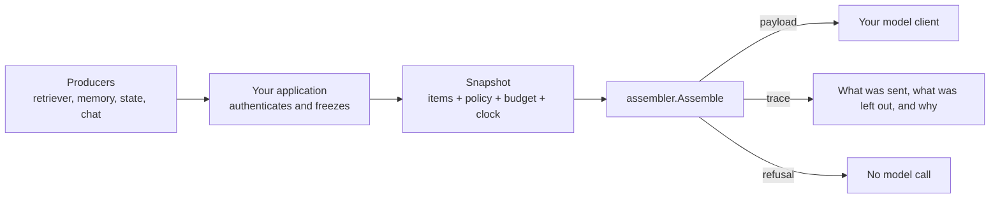

# assembler-go

[](https://github.com/contextwindowarchitecture/assembler-go/actions/workflows/ci.yml)
[](https://pkg.go.dev/github.com/contextwindowarchitecture/assembler-go)
[](go.mod)
[](https://contextwindowarchitecture.io/spec.html)
[](LICENSE)

Decide what your model sees, and keep a record of why.

assembler-go is a Go assembler for the [Context Window Architecture](https://contextwindowarchitecture.io) (CWA) specification. You give it everything that *could* go into a model request. It gives back the exact request to send and a trace of every decision. When the request would break your policy, it gives back a refusal instead, before any model is called.

## What is assembler-go

Most applications build a prompt by gluing strings together: a system prompt, some retrieved chunks, the chat history and the question. That works until something goes wrong. Then nobody can say which chunks were sent, which were dropped to fit the context window, or why a retrieved web page ended up next to the system prompt.

CWA treats the request as compiled output instead:

1. **Producers** (your retriever, memory store, account service, chat history) propose typed **items** for named **slots**.
2. **Your application** freezes those items, a versioned **route policy** and a **budget** into an immutable **snapshot**.
3. **The assembler** turns the snapshot into a **payload**, the exact bytes to send, and a **trace** that says what went in, what was left out and why. When the snapshot can't produce a request that meets the policy, the assembler returns a **refusal** with the trace instead.



`Assemble` is a pure function. It reads nothing outside the snapshot, so the same snapshot always yields the same bytes and the same trace. You can store a snapshot and replay it later to debug an answer, review a policy change, or audit what a model was shown.

assembler-go **is not** a retriever, an LLM client, an agent framework or a prompt template library. It sits between the code that gathers context and the code that calls the model, and works with whatever you already use on either side.

## Status

assembler-go is a draft that tracks the CWA draft specification (`cwa/draft`), so the API and snapshot format can change before v1. The committed [conformance report](conformance-report.json) records the result for each published case and rejection. There is no semver tag yet; install from the `draft-release` prerelease tag.

## Install

```sh
go get github.com/contextwindowarchitecture/assembler-go@draft-release
```

It requires Go 1.26 or newer. The package is `assembler`.

## Quickstart

A support bot gets a question. The retriever found two chunks, and only one of them is relevant.

```go
import (
	"errors"
	"fmt"

	assembler "github.com/contextwindowarchitecture/assembler-go"
)

// assembleRequest assembles one request from snapshot, the frozen JSON: items, route policy, placement profile,
// budget, tokenizer, renderer and clock.
func assembleRequest(snapshot []byte) error {
	result, err := assembler.Assemble(snapshot, assembler.Options{})
	var rejected *assembler.SnapshotRejectedError
	switch {
	case errors.As(err, &rejected):
		return err // the snapshot is invalid: no payload and no trace; rejected.Problem says why
	case err != nil:
		return err // e.g. *assembler.UnsupportedComponentError for a tokenizer or renderer this package lacks
	case result.Payload == nil:
		fmt.Println("refused:", result.Trace["refused"].(map[string]any)["reason"])
	default:
		// result.Payload is the request to send: {"messages": [...], "system": [...], "tools": [...]}
	}
	for _, row := range result.Trace["excluded"].([]any) {
		fmt.Println(row.(map[string]any)["item_id"], row.(map[string]any)["reason"]) // kb:pricing below_threshold
	}
	return nil
}
```

[examples/quickstart](examples/quickstart/main.go) is the complete, runnable version, with the policy, the profile and the items written out, and its tests run the function above:

```sh
go run ./examples/quickstart
```

```text
{
  "system": "Answer from the evidence only, and say so when it does not cover the question.",
  "messages": [
    {
      "content": "<evidence id=\"kb:refunds\">\nPro plans can be refunded in full within 30 days of purchase.\n</evidence>\n<query id=\"turn:1\">\nCan I get a refund on my Pro plan?\n</query>\n",
      "role": "user"
    }
  ]
}

62 tokens; left out:
  kb:pricing  below_threshold

refused: evidence_required, recovery: request_context
```

The example prints the request after mapping it for the Anthropic Messages API, so `system` is one string here rather than the renderer's list (see [Sending the payload to a model](#sending-the-payload-to-a-model)). The low-scoring chunk was left out, and the trace says why. When the retriever finds nothing, the route requires evidence, so the assembler refuses before any model is called. The trace then suggests what to do next.

## Core concepts

| Term | What it is |
| --- | --- |
| **Item** | One piece of candidate context, such as an instruction, a retrieved chunk, a memory, a tool result or a chat turn. It carries its source, version, freshness, authority and trust alongside its body. |
| **Slot** | Where an item belongs: `governance.instructions`, `evidence.knowledge`, `interaction.history` and so on. Each slot has defaults for authority, protection and trust. |
| **Producer** | The component that proposes items, such as a retriever, a memory store or a state service. The route policy limits which slots it may write. |
| **Route policy** | Versioned rules for one route: which producers it accepts, relevance thresholds, caps, what to do about conflicts, and whether evidence is required. |
| **Placement profile** | Versioned layout: where each slot renders in the request (system, tools, or a tagged block in the user message). |
| **Snapshot** | Everything assembly may look at, frozen. The trace's `context.snapshot_digest` is its replay key. |
| **Payload** | The exact bytes to send, written by a renderer. |
| **Trace** | Every item included, compressed or excluded, each exclusion with a registered reason code, plus any conflicts and the token count. |
| **Refusal** | No payload, a trace saying why, and, where one applies, a suggested recovery. |

The [specification](https://contextwindowarchitecture.io/spec.html) defines each of these precisely.

## Sending the payload to a model

The `cwa-messages/v1` renderer writes a provider-neutral request as JSON:

```json
{"system": [{"id": "...", "text": "..."}], "tools": [{"id": "...", "text": "..."}], "messages": [{"role": "user", "content": "..."}]}
```

Only governance items reach `system` and `tools`. Everything else, prior turns included, is escaped into a single user message. Mapping that onto a provider's request takes a few lines. The package doesn't export them; [examples/quickstart](examples/quickstart/main.go) defines both for you to copy:

- `toAnthropic` joins the system entries into one `system` string, as the Anthropic Messages API takes it, and passes `messages` through.
- `toOpenAI` turns each system entry into a `{"role": "system"}` message ahead of the others, as OpenAI Chat Completions and compatible servers take it.

If you use prompt caching, the optional `cwa-message-blocks/v1` renderer writes the same request, with the user message split into one `{id, text}` block per item. That lets you place a cache breakpoint at any item boundary. It counts each block on its own, so with a tokenizer that rounds each text up, such as `estimate-utf8/v1`, fewer items may fit than under `cwa-messages/v1`.

## Framework-agnostic and compatibility

- **No framework or SDK lock-in.** The input is JSON bytes and the output is bytes. Producers can be built on any retrieval stack, database or vector store, and the payload goes to whichever client you already use.
- **Small.** It has three direct dependencies (`regexp2`, `santhosh-tekuri/jsonschema`, `ucarion/jcs`), no network access and no model calls. The schemas and contract tables are embedded.
- **Go 1.26 and newer.** CI tests Go 1.26 and 1.27.
- **Byte-identical across languages.** The [Python](https://github.com/contextwindowarchitecture/assembler-python), [TypeScript](https://github.com/contextwindowarchitecture/assembler-typescript) and [Rust](https://github.com/contextwindowarchitecture/assembler-rust) assemblers pass the same conformance cases. A snapshot frozen in one service can be assembled, or replayed, in another.
- **Cost grows with budget pressure.** Every reduction under budget pressure is its own fit test, and every fit test renders and counts the whole payload. Keep the cost down at the source: send no more chunks than the route's budget can use, and bound slots with `max_per_source` or `max_tokens`.
- **Built-in components.** Each one is named by id in the snapshot:

| Kind | Id | Use it for |
| --- | --- | --- |
| Tokenizer | `estimate-utf8/v1` | A portable estimate (UTF-8 bytes ÷ 4, rounded up) for models without a local tokenizer; pair it with `budget.margin_percent` |
| Tokenizer | `fixture-whitespace/v1` | Conformance tests only |
| Renderer | `cwa-messages/v1` | Chat-style model APIs |
| Renderer | `cwa-message-blocks/v1` | The same request with per-item blocks for prompt caching (optional in the spec) |
| Renderer | `fixture-xml/v1` | Conformance tests: one plain-text block, with no system channel |

For exact counts, pass your model's own tokenizer (see [Extending](#extending)).

## Security model

The assembler enforces the structural rules the spec gives it. It cannot see everything, so the "does not do" half of this section matters as much as the first.

**What the assembler enforces:**

- **Nothing outside the snapshot.** `Assemble` reads no network, files, environment, clock or model, so a request can be replayed and audited from its snapshot.
- **Validation at the boundary.** A snapshot that fails its schemas or the spec's checks is rejected whole, and no payload is produced. `Assemble` takes the raw bytes, so validation sees the JSON as written.
- **Producers stay in their lane.** The route policy lists which producer may write which slot, and a producer's kind narrows that further. For example, a retriever can only add evidence.
- **Authority comes from the slot, not the wording.** Only governance items render into the system and tools channels. Retrieved text, tool output, memory and user turns are escaped into the user message, so a chunk containing `</evidence><system>…` stays inert text. Untrusted authority is accepted only in tool results, memory and history.
- **Tools come from an allow-list.** A tool is offered only when the capability grant's producer, listed by the route, proposes it, and it is on the grant's allow-list.
- **Refusal before the model call.** A missing required slot, protected content that won't fit, an unresolved conflict or missing evidence produces a refusal, not a degraded prompt.

**What it does not do:**

- **It doesn't authenticate producers.** Your application binds an identity to each batch. The assembler trusts that binding and checks only that the route lists the producer.
- **It doesn't detect or neutralize prompt injection.** Marking and separating untrusted content limits where that content can appear. It does not stop a model from following instructions written inside it.
- **It doesn't sanitize content or redact personal data.** Scope checks compare declared scope fields; they don't inspect bodies.
- **It doesn't check tool calls.** It decides which tools are offered. Checking each call before it runs is the application's job.
- **It doesn't pin profiles or policies.** assembler-go has no registry. Keep profile and route-policy versions pinned in your application, and deploy only profiles evaluated for your model.

## Extending

**Your own tokenizer.** A `Tokenizer` is a `func(string) int`. Pass it in `Options.Tokenizers` for one call, keyed by the id your snapshot's `tokenizer` names:

```go
import (
	"unicode/utf8"

	assembler "github.com/contextwindowarchitecture/assembler-go"
)

// assembleWithOwnTokenizer counts one token per character, for a snapshot whose "tokenizer" is "my-chars/v1".
func assembleWithOwnTokenizer(snapshot []byte) (assembler.Result, error) {
	chars := func(text string) int { return utf8.RuneCountInString(text) }
	return assembler.Assemble(snapshot, assembler.Options{
		Tokenizers: map[string]assembler.Tokenizer{"my-chars/v1": chars},
	})
}
```

The id can't be one the spec publishes (`fixture-whitespace/v1` or `estimate-utf8/v1`), because a trace naming a published tokenizer must mean that tokenizer's count. Load anything it needs before the call, since `Assemble` reads nothing else. If it estimates, reserve headroom with `budget.margin_percent`.

**Renderers are fixed.** assembler-go takes no application renderers. `Options` has no field for one, and a snapshot must name one of the three built-in renderers.

**Timings.** The trace has no stage timings. Time the call yourself if you need to.

## Examples

| Where | What |
| --- | --- |
| [examples/quickstart](examples/quickstart/main.go) | One request assembled, one refused, and the payload mapped onto two provider request shapes |
| [contextwindowarchitecture/examples](https://github.com/contextwindowarchitecture/examples) | Five runnable apps built on CWA, from a help-center Q&A bot to a production-shaped agent. They're written in Python, but the snapshots and payloads are the same in Go. |
| [contextwindowarchitecture/assembler-demo](https://github.com/contextwindowarchitecture/assembler-demo) | An inspector that runs the same question through this and the other three assemblers and shows every decision |
| [contextwindowarchitecture/integrations](https://github.com/contextwindowarchitecture/integrations) | CWA placed inside existing systems |

## Documentation

| Read | For |
| --- | --- |
| [The specification](https://contextwindowarchitecture.io/spec.html) | What CWA requires, requirement by requirement |
| [Producer guide](https://github.com/contextwindowarchitecture/contextwindowarchitecture/blob/main/guides/producers.md) | How to write the items you put in a snapshot |
| [Assembler guide](https://github.com/contextwindowarchitecture/contextwindowarchitecture/blob/main/guides/assemblers.md) | How an assembler behaves, renderer by renderer |
| [vendor/cwa/conformance/README.md](vendor/cwa/conformance/README.md) | Every ordering, tie-break and algorithm step this package follows |
| [Package docs](https://pkg.go.dev/github.com/contextwindowarchitecture/assembler-go) | The API, and the exact rules for which error `Assemble` returns, and when |
| [conformance-report.json](conformance-report.json) | The result for each conformance case |

## Developing

```sh
go mod download
go build ./...
go test ./...
```

Changes are made test-first, one behavior per commit, from the published spec alone. The contract is vendored from the specification repository and never edited here. [CONTRIBUTING.md](CONTRIBUTING.md) covers the workflow, conformance and releases, [AGENTS.md](AGENTS.md) holds the full rules, and [PORTING.md](PORTING.md) is the guide this port was built from.

## Other implementations

| Language | Repository |
| --- | --- |
| Python (reference) | [assembler-python](https://github.com/contextwindowarchitecture/assembler-python) |
| TypeScript | [assembler-typescript](https://github.com/contextwindowarchitecture/assembler-typescript) |
| Rust | [assembler-rust](https://github.com/contextwindowarchitecture/assembler-rust) |
| A new language | [assembler-template](https://github.com/contextwindowarchitecture/assembler-template) |

## License

Apache License 2.0, the same as the specification. See [LICENSE](LICENSE) and [NOTICE](NOTICE). The vendored contract under `vendor/cwa/` comes from the specification repository under the same license.
